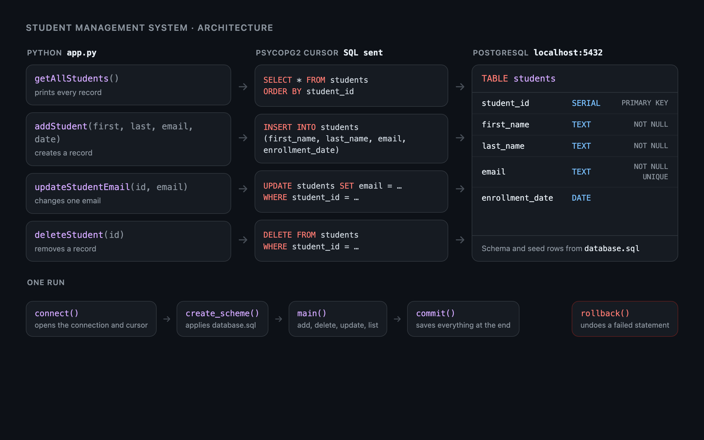

# Student Management System (SMS)

A small Python program that connects to a database and performs CRUD operations for student records.

▶️ [Watch the video demo](https://youtu.be/9N-XBiOqaWY)

## Features
- List all students
- Add a new student
- Update a student's email by their id
- Delete a student record by their id

## Architecture



Every query passes its values to psycopg2 as parameters (`%s`), so names and emails with quotes are
stored as plain text and can't change the SQL.

## Functions (API)
- `connect()`: connects to the PostgreSQL server.
- `create_scheme(path="database.sql")`: creates the `students` table and its sample rows.
- `getAllStudents()`: prints every student record.
- `addStudent(first_name, last_name, email, enrollment_date)`: inserts a new student.
- `updateStudentEmail(student_id, new_email)`: updates a student's email by ID.
- `deleteStudent(student_id)`: removes a student record by ID.

## Installation
1. Clone the repository:
    ```
    git clone https://github.com/Siddigz/Student-Management-System-SMS.git
    ```
2. Navigate to the directory:
    ```
    cd .\Student-Management-System-SMS\
    ```
3. Install dependencies:
    ```
    pip install -r requirements.txt
    ```


## Running the Application

1. Prerequisites
    - Python 3.8+ and pip
    - PostgreSQL server running and accessible

2. Configure the database connection in app.py
      ```
        DB_USER = "postgres"
        DB_PASS = "sql123"
        DB_HOST = "localhost"
        DB_PORT = "5432" 
      ```

3. Create the database and table (if not done already)
    - Create the students table according to database.sql file

4. Run the application
    - Start the program using:
      ```
      py app.py
      ```

## Video demonstration

[](https://youtu.be/9N-XBiOqaWY)

Watch it on YouTube: https://youtu.be/9N-XBiOqaWY


